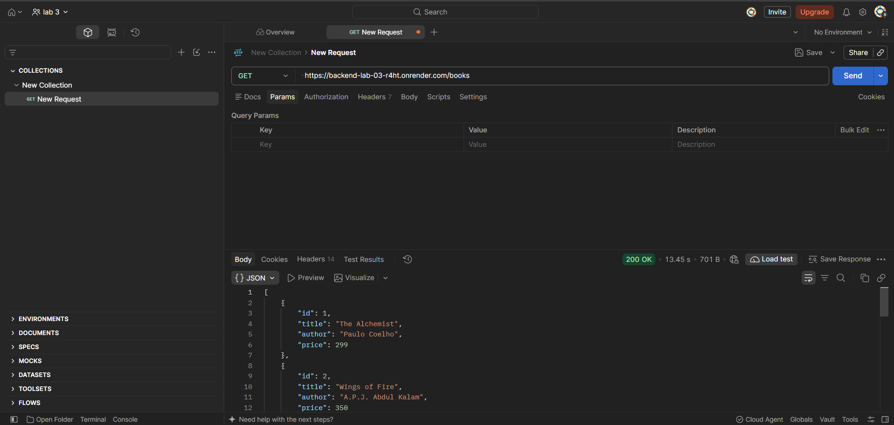
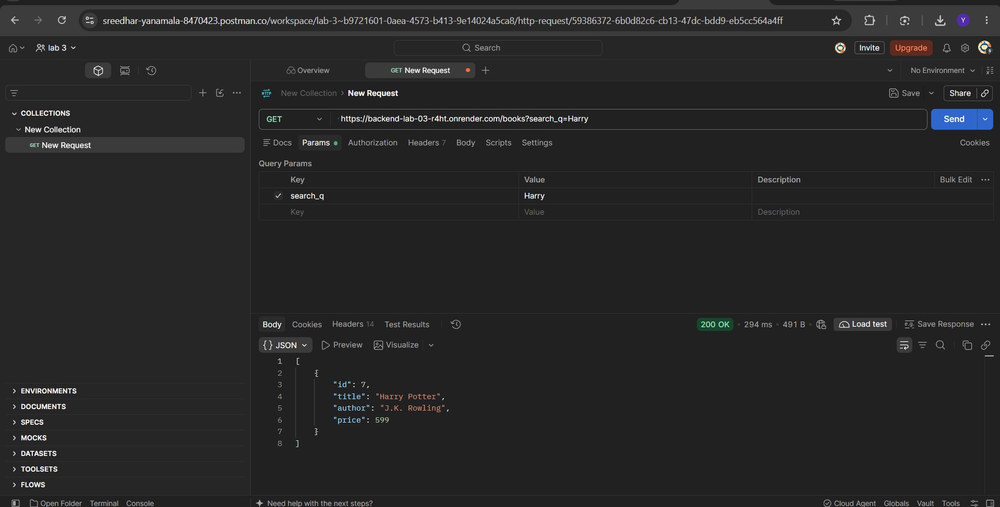
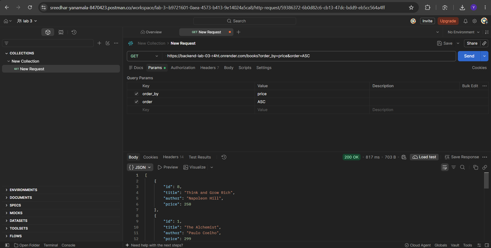
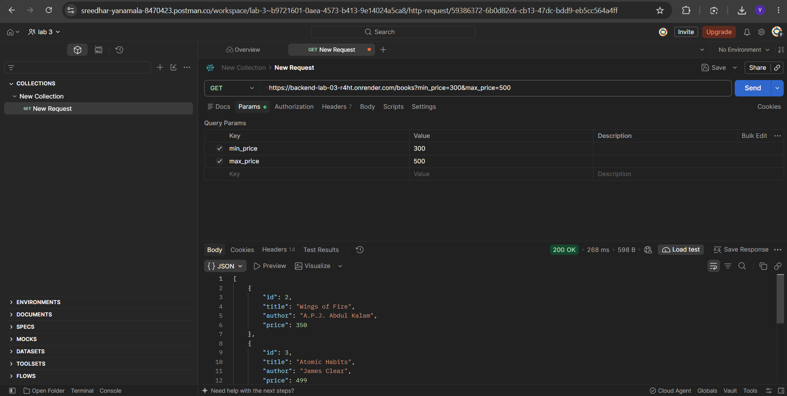
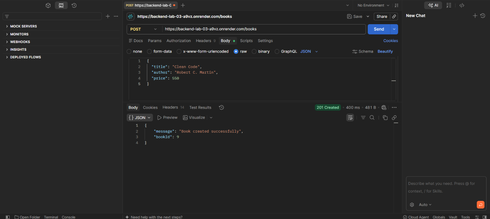
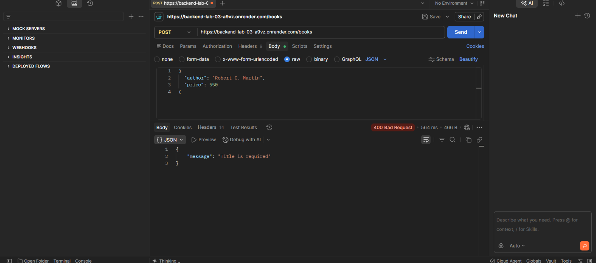
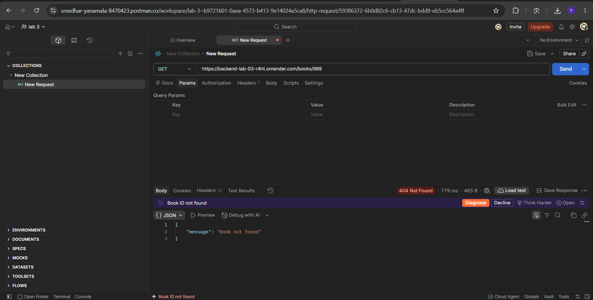

# Lab 3: REST API, Query Parameters, Validation, Debugging

## Student Details

Name: YANAMALA SREEDHAR
Registration Number: 252U1R1260
Section: CSE-2E(211) 

---

## Live Link

https://backend-lab-03-a9vz.onrender.com/

---

## Objective

The objective of Lab 3 is to build upon the fundamentals of RESTful API development introduced in Lab 2. In this lab, we develop a complete, secure, and production-ready Books REST API using Node.js, Express, and SQLite. 

Key objectives include:
- Implementing standard RESTful routing conventions using nouns for resources (`/books`) and appropriate HTTP verbs (`GET`, `POST`, `PUT`, `DELETE`).
- Handling complex query parameters for search (`search_q`), sorting (`order_by`, `order`), pagination (`limit`, `offset`), and price range filtering (`min_price`, `max_price`).
- Protecting the database from SQL Injection by employing parameterized queries (`?`) and strict whitelist mapping for SQL keywords and identifiers.
- Applying robust request body validation with descriptive, consistent JSON error responses (`{ "message": "..." }`).
- Returning semantically accurate HTTP status codes (`200 OK`, `201 Created`, `400 Bad Request`, `404 Not Found`, `500 Internal Server Error`).
- Identifying, diagnosing, and resolving common backend runtime bugs such as `EADDRINUSE`, invalid module import paths, missing database tables, and unhandled asynchronous Promises (`missing await`).

---

## Technologies Used

- Node.js
- Express.js
- SQLite
- Postman
- JavaScript

---

## How to Run

### 1. Install dependencies

```bash
npm install
```

### 2. Environment Variables

```env
PORT=3000
```

> **Note:** Do not include real secret values. If `PORT` is omitted, the application defaults to `3000`.

### 3. Start the server

```bash
node app.js
```

Or using the npm start script:

```bash
npm start
```

When the server starts successfully, the terminal displays:
```text
Database initialized with sample books.
Server running on port 3000
```

---

## API Endpoints

| Method | Endpoint | Description |
| :--- | :--- | :--- |
| **GET** | `/` | Check whether API is running |
| **GET** | `/books` | Get books with search, sorting, filters and pagination |
| **GET** | `/books/:id` | Get one book |
| **POST** | `/books` | Create a book |
| **PUT** | `/books/:id` | Update a book |
| **DELETE** | `/books/:id` | Delete a book |

---

## Query Parameters

The `GET /books` endpoint supports the following query parameters with sensible defaults:

- **`search_q`** (Default: `""`): Performs a case-insensitive partial match search on book titles using SQL `LIKE ?` with parameterized wildcards (`%search_q%`).
- **`order_by`** (Default: `"id"`): Specifies the column to sort by. Allowed values are validated against a strict whitelist: `id`, `title`, `author`, `price`.
- **`order`** (Default: `"ASC"`): Specifies sort order direction. Allowed values: `ASC` (ascending) or `DESC` (descending).
- **`limit`** (Default: `10`): Maximum number of book records to return. Must be a positive integer.
- **`offset`** (Default: `0`): Number of book records to skip for pagination. Must be a non-negative integer.
- **`min_price`** (Default: none): Filters books with `price >= min_price`. Must be a non-negative number.
- **`max_price`** (Default: none): Filters books with `price <= max_price`. Must be a non-negative number.

When both `min_price` and `max_price` are provided, the API uses `price BETWEEN ? AND ?`. All parameters work simultaneously together.

---

## Validation

The API performs thorough server-side validation and returns consistent error responses formatted as `{ "message": "..." }`:

- **Missing Title:** If `title` is missing, null, or empty string on `POST` or `PUT`, returns `400 Bad Request` with `{ "message": "Title is required" }`.
- **Missing Author:** If `author` is missing, null, or empty string on `POST` or `PUT`, returns `400 Bad Request` with `{ "message": "Author is required" }`.
- **Missing Price:** If `price` is missing, null, or empty string on `POST` or `PUT`, returns `400 Bad Request` with `{ "message": "Price is required" }`.
- **Non-numeric Price:** If `price` is not a valid number (e.g., `"abc"` or boolean), returns `400 Bad Request` with `{ "message": "Price must be a number" }`. Negative prices return `{ "message": "Price must be a positive number" }`.
- **Invalid Query Parameters:** If `order_by` is not one of `id`, `title`, `author`, `price`, or `order` is not `ASC` or `DESC`, or `limit`/`offset` are not valid integers, returns `400 Bad Request`.
- **Invalid Price Range:** If `min_price` is greater than `max_price`, returns `400 Bad Request` with `{ "message": "min_price cannot be greater than max_price" }`.

---

## Status Codes

| Status Code | Meaning | When It Is Used in This Project |
| :---: | :--- | :--- |
| **`200 OK`** | Success | Returned for successful `GET` queries (list or single item), successful `PUT` updates, and successful `DELETE` removals. |
| **`201 Created`** | Created | Returned for successful `POST /books` book creation along with the generated `bookId`. |
| **`400 Bad Request`** | Validation Error | Returned when required fields are missing, invalid data types are supplied, query parameters fail whitelist validation, or `min_price > max_price`. |
| **`404 Not Found`** | Not Found | Returned when a book ID does not exist in the database for `GET /books/:id`, `PUT /books/:id`, or `DELETE /books/:id`, and for undefined endpoints. |
| **`500 Internal Server Error`** | Server Error | Returned if an unhandled database exception or internal runtime error occurs. |

---

## Screenshots

Add screenshots using:















---

## Debugging Notes

During development and testing of this lab, the following common backend errors were identified and resolved:

### 1. Error: EADDRINUSE
- **Problem:** `Error: listen EADDRINUSE: address already in use :::3000`
- **Cause:** Another running process or previous Node.js terminal session was already occupying port 3000.
- **Solution:** Terminated the previous process occupying the port and made the application port dynamic using `const PORT = process.env.PORT || 3000;`. This allows running on any alternate port via environment variables without changing source code.

### 2. Error: Wrong import path
- **Problem:** `Error: Cannot find module 'sqlite3'` or `Cannot find module './goodreads.db'`
- **Cause:** Module dependencies were not installed or the relative path string was incorrect.
- **Solution:** Ensured dependencies are listed in `package.json` (`sqlite`, `sqlite3`), executed `npm install`, and used standard absolute path resolution with `path.join(__dirname, "goodreads.db")`.

### 3. Error: No such table
- **Problem:** `SQLITE_ERROR: no such table: books`
- **Cause:** The SQL query used the table name `books`, but the table had not yet been created, or was named inconsistently (e.g., `book`).
- **Solution:** Added automated schema creation in `initializeDBAndServer` using `CREATE TABLE IF NOT EXISTS books (...)` before handling incoming requests, and verified that all queries throughout `app.js` consistently use the plural name `books`.

### 4. Error: Missing await
- **Problem:** Route handlers returned pending Promises (`[object Promise]`) or sent empty responses, and `result.lastID` was undefined.
- **Cause:** `sqlite` database operations (`open`, `run`, `all`, `get`) are asynchronous I/O tasks that return Promises. Without `await`, execution continues synchronously before the database query resolves.
- **Solution:** Marked route handlers `async (req, res) => { ... }` and prepended `await` to every database call (e.g., `const books = await db.all(query, params);`).

---

## Postman Testing

Test the API using the following 18 comprehensive test cases in Postman. These cover both SUCCESS and FAILURE scenarios:

### Test 1: Health Check Root Route
- **Method:** `GET`
- **URL:** `http://localhost:3000/`
- **Expected Status:** `200 OK`
- **Expected Response:**
  ```json
  {
    "message": "Lab 3 REST API is running"
  }
  ```

### Test 2: GET All Books (Defaults)
- **Method:** `GET`
- **URL:** `http://localhost:3000/books`
- **Expected Status:** `200 OK`
- **Expected Response:** Array of up to 10 books sorted by `id ASC`.

### Test 3: Search by Title (`search_q`)
- **Method:** `GET`
- **URL:** `http://localhost:3000/books?search_q=Harry`
- **Expected Status:** `200 OK`
- **Expected Response:** Array containing "Harry Potter" book details.

### Test 4: Sorting by Price Ascending (`order_by` & `order=ASC`)
- **Method:** `GET`
- **URL:** `http://localhost:3000/books?order_by=price&order=ASC`
- **Expected Status:** `200 OK`
- **Expected Response:** Array of books ordered from lowest to highest price.

### Test 5: Sorting by Price Descending (`order_by` & `order=DESC`)
- **Method:** `GET`
- **URL:** `http://localhost:3000/books?order_by=price&order=DESC`
- **Expected Status:** `200 OK`
- **Expected Response:** Array of books ordered from highest to lowest price.

### Test 6: Pagination (`limit` and `offset`)
- **Method:** `GET`
- **URL:** `http://localhost:3000/books?limit=3&offset=0`
- **Expected Status:** `200 OK`
- **Expected Response:** First 3 books (IDs 1, 2, 3).
- **Next Page:** `GET http://localhost:3000/books?limit=3&offset=3` returns the next 3 books (IDs 4, 5, 6).

### Test 7: Price Range Filtering (`min_price` and `max_price`)
- **Method:** `GET`
- **URL:** `http://localhost:3000/books?min_price=300&max_price=500`
- **Expected Status:** `200 OK`
- **Expected Response:** Array of books with price between 300 and 500 inclusive.

### Test 8: Combined Query Parameters
- **Method:** `GET`
- **URL:** `http://localhost:3000/books?search_q=the&min_price=200&max_price=500&order_by=price&order=DESC&limit=5&offset=0`
- **Expected Status:** `200 OK`
- **Expected Response:** Books with "the" in title, price between 200 and 500, ordered by price descending, limit 5.

### Test 9: GET One Existing Book
- **Method:** `GET`
- **URL:** `http://localhost:3000/books/1`
- **Expected Status:** `200 OK`
- **Expected Response:**
  ```json
  {
    "id": 1,
    "title": "The Alchemist",
    "author": "Paulo Coelho",
    "price": 299
  }
  ```

### Test 10: GET Non-Existing Book (404 Handling)
- **Method:** `GET`
- **URL:** `http://localhost:3000/books/999`
- **Expected Status:** `404 Not Found`
- **Expected Response:**
  ```json
  {
    "message": "Book not found"
  }
  ```

### Test 11: POST Valid Book
- **Method:** `POST`
- **URL:** `http://localhost:3000/books`
- **Headers:** `Content-Type: application/json`
- **Request Body:**
  ```json
  {
    "title": "Clean Code",
    "author": "Robert C. Martin",
    "price": 550
  }
  ```
- **Expected Status:** `201 Created`
- **Expected Response:**
  ```json
  {
    "message": "Book created successfully",
    "bookId": 9
  }
  ```

### Test 12: POST Without Title (Validation Error)
- **Method:** `POST`
- **URL:** `http://localhost:3000/books`
- **Headers:** `Content-Type: application/json`
- **Request Body:**
  ```json
  {
    "author": "Robert C. Martin",
    "price": 550
  }
  ```
- **Expected Status:** `400 Bad Request`
- **Expected Response:**
  ```json
  {
    "message": "Title is required"
  }
  ```

### Test 13: POST Without Author (Validation Error)
- **Method:** `POST`
- **URL:** `http://localhost:3000/books`
- **Headers:** `Content-Type: application/json`
- **Request Body:**
  ```json
  {
    "title": "Clean Code",
    "price": 550
  }
  ```
- **Expected Status:** `400 Bad Request`
- **Expected Response:**
  ```json
  {
    "message": "Author is required"
  }
  ```

### Test 14: POST With Non-Numeric Price (Validation Error)
- **Method:** `POST`
- **URL:** `http://localhost:3000/books`
- **Headers:** `Content-Type: application/json`
- **Request Body:**
  ```json
  {
    "title": "Clean Code",
    "author": "Robert C. Martin",
    "price": "abc"
  }
  ```
- **Expected Status:** `400 Bad Request`
- **Expected Response:**
  ```json
  {
    "message": "Price must be a number"
  }
  ```

### Test 15: PUT Existing Book
- **Method:** `PUT`
- **URL:** `http://localhost:3000/books/1`
- **Headers:** `Content-Type: application/json`
- **Request Body:**
  ```json
  {
    "title": "The Alchemist - 25th Anniversary Edition",
    "author": "Paulo Coelho",
    "price": 350
  }
  ```
- **Expected Status:** `200 OK`
- **Expected Response:**
  ```json
  {
    "message": "Book updated successfully"
  }
  ```

### Test 16: PUT Non-Existing Book
- **Method:** `PUT`
- **URL:** `http://localhost:3000/books/999`
- **Headers:** `Content-Type: application/json`
- **Request Body:**
  ```json
  {
    "title": "Non-existent Book",
    "author": "Ghost Author",
    "price": 400
  }
  ```
- **Expected Status:** `404 Not Found`
- **Expected Response:**
  ```json
  {
    "message": "Book not found"
  }
  ```

### Test 17: DELETE Existing Book
- **Method:** `DELETE`
- **URL:** `http://localhost:3000/books/9`
- **Expected Status:** `200 OK`
- **Expected Response:**
  ```json
  {
    "message": "Book deleted successfully"
  }
  ```

### Test 18: DELETE Non-Existing Book
- **Method:** `DELETE`
- **URL:** `http://localhost:3000/books/999`
- **Expected Status:** `404 Not Found`
- **Expected Response:**
  ```json
  {
    "message": "Book not found"
  }
  ```

---

## Deployment on Render

This application is ready for deployment on [Render](https://render.com/).

### Deployment Steps:
1. **Push to GitHub**:
   Initialize git and push the `lab-03` repository:
   ```bash
   git init
   git add .
   git commit -m "Initial Lab 3 REST API setup"
   git branch -M main
   git remote add origin https://github.com/<your-username>/<your-repo-name>.git
   git push -u origin main
   ```
2. **Create Web Service on Render**:
   - Go to Render Dashboard and select **New + > Web Service**.
   - Connect your GitHub repository.
   - Configure service details:
     - **Name:** `backend-lab-3-books-api`
     - **Runtime:** `Node`
     - **Build Command:** `npm install`
     - **Start Command:** `npm start` (or `node app.js`)
     - **Instance Type:** Free
3. **Environment Configuration**:
   - Render automatically sets `process.env.PORT`. The application dynamically binds to this port using:
     ```javascript
     const PORT = process.env.PORT || 3000;
     ```
   - No custom environment variables or external databases are required.
4. **Access Live API**:
   - Once deployed, copy your Render URL (e.g., `https://backend-lab-3-books-api.onrender.com`).
   - Add it to the **Live Link** section of this README.

### SQLite Ephemeral Storage Limitation on Render
> **Important Note on Production Persistence:**  
> SQLite is a local file-based database (`goodreads.db`). Free-tier hosting platforms like Render, Railway, and Heroku use ephemeral container filesystems. When a free instance spins down due to inactivity (after 15 minutes) or restarts during a redeploy, changes made to the database file (such as added, updated, or deleted books) are reset back to the initial seed state. For permanent enterprise persistence in production, client-server databases like PostgreSQL or MySQL are used. However, for academic lab purposes, SQLite provides a lightweight, zero-configuration, and fully self-contained solution.

---

## Viva Questions and Answers

### 1. What is a REST API?
A REST API (Representational State Transfer API) is an architectural style for building networked web applications. It allows clients to interact with server-side resources over HTTP using standard HTTP methods and JSON data format.

### 2. Why are endpoints named using nouns?
In REST, endpoints represent **resources** (things or entities, like `/books`), not actions. The action to perform on that resource is determined by the **HTTP method** (`GET` to read, `POST` to create, `PUT` to update, `DELETE` to remove). Using verbs in URLs (e.g. `/getBooks`) violates REST conventions.

### 3. What is the difference between a query parameter and a path parameter?
- A **path parameter** identifies a specific, individual resource (e.g., `/books/1` targets book #1). It is part of the URL route hierarchy.
- A **query parameter** is used to filter, sort, search, or paginate a collection of resources (e.g., `/books?limit=5`). It appears after `?` in key-value pairs.

### 4. Give an example of a query parameter.
```http
GET /books?search_q=Harry
```
Here, `search_q=Harry` is a query parameter filtering books whose title contains "Harry".

### 5. Give an example of a path parameter.
```http
GET /books/3
```
Here, `3` is a path parameter (captured via `:id` in Express) identifying the unique book with ID 3.

### 6. What does stateless mean in REST?
Stateless means that each HTTP request from the client must contain all necessary information for the server to process it. The server does not store any client session state between requests.

### 7. Why is POST returning 201?
HTTP status `201 Created` indicates that the request was successful and resulted in the creation of a new resource on the server.

### 8. Why is GET returning 200?
HTTP status `200 OK` is the standard response for successful HTTP requests where data was retrieved and returned to the client.

### 9. Why is invalid input returning 400?
HTTP status `400 Bad Request` indicates a client-side error, notifying the client that required fields were missing, malformed, or failed validation.

### 10. Why is a missing book returning 404?
HTTP status `404 Not Found` indicates that the specific resource requested by the client does not exist on the server.

### 11. What is parameterized SQL?
Parameterized SQL uses placeholders (`?`) in query strings and passes data values separately in an array. The database engine treats the values strictly as data, never as executable code.

### 12. Why should we not directly insert user input into SQL?
Directly concatenating raw user input into SQL query strings creates an SQL Injection vulnerability, allowing attackers to manipulate queries, steal data, or destroy tables.

### 13. What is SQL injection?
SQL Injection (SQLi) is a security exploit where an attacker inserts malicious SQL statements into user input fields to execute unauthorized database commands.

### 14. Why do we use LIKE?
The SQL `LIKE` operator is used with the `%` wildcard to perform pattern matching for partial searches (e.g. `title LIKE ?` with `%Harry%` finds "Harry Potter").

### 15. What are LIMIT and OFFSET?
- `LIMIT` defines the maximum number of records to return.
- `OFFSET` defines the number of records to skip before returning rows. Together they enable pagination.

### 16. Why do we validate order_by?
SQL column names cannot be parameterized using `?` placeholders. We must validate `order_by` against a whitelist (`id`, `title`, `author`, `price`) to prevent SQL injection.

### 17. What is async/await?
`async/await` is modern JavaScript syntax that allows asynchronous, Promise-based code to be written and read like synchronous code, making error handling with `try/catch` simple and clean.

### 18. What causes EADDRINUSE?
`EADDRINUSE` occurs when the application tries to listen on a network port (e.g., 3000) that is already being used by another running process.

### 19. What causes "no such table"?
The SQLite error `no such table: books` occurs when a query targets a table that does not exist in the database, caused by a misspelled table name or forgetting to run the initial `CREATE TABLE` query.

### 20. Why is await important for database operations?
Database operations are asynchronous I/O calls that return Promises. Without `await`, the code continues immediately with a pending Promise rather than waiting for the resolved query result.

---

## Conclusion

In Lab 3, we successfully extended our Lab 2 foundation to develop a complete, robust, and REST-compliant Books API. We learned how to handle complex query parameters for search, whitelisted sorting, pagination, and range filtering safely using parameterized SQL queries. We implemented strict request body validation, standardized JSON error responses, adhered to semantic HTTP status codes, and gained practical experience diagnosing common backend runtime errors like `EADDRINUSE` and missing `await`.

